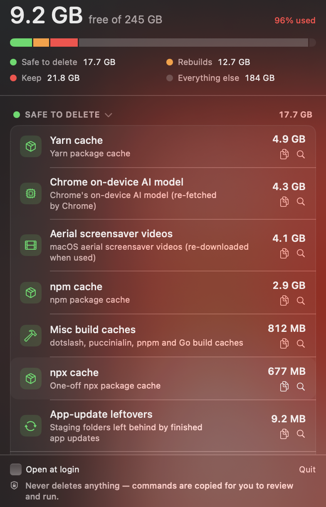

# Storage Analysis

A tiny macOS menu-bar app that finds the gigabytes your Mac quietly hoards — package caches, browser downloads, app-update leftovers, VM images — sorts them into **safe to delete**, **safe but rebuilds** and **keep**, and copies the exact cleanup command for you to run.

**It never deletes anything itself.** It only reads sizes (`du`, `df`) and copies commands to your clipboard.

**Website & download:** https://sarthak090.github.io/storage-analysis/



## Install

Requires macOS 14 Sonoma or later. One universal download for Apple silicon and Intel.

1. **Download** [StorageAnalysis.dmg](https://github.com/sarthak090/storage-analysis/releases/latest/download/StorageAnalysis.dmg) from the latest release.
2. **Drag it into Applications.** Open the .dmg and drag `StorageAnalysis` onto the `Applications` folder.
3. **Allow it to open — once.** The app isn't notarized by Apple (that needs a paid developer account), so the first launch is blocked with a "could not verify" message. Click **Done**, then go to **System Settings → Privacy & Security**, scroll down and click **Open Anyway**. Or, in Terminal:
   ```sh
   xattr -dr com.apple.quarantine /Applications/StorageAnalysis.app
   ```
4. **Find it in the menu bar.** There's no window or Dock icon — look for a drive symbol with your free space (a warning triangle above 90% full). Click it.
5. **Clean up on your terms.** Click the copy icon on a green or orange row, paste into Terminal, read the command, press Return. Quit the owning app first (e.g. Chrome before deleting its AI model). Click ↻ to rescan.

To uninstall, quit it from the popover and drag `StorageAnalysis.app` to the Trash.

## What it scans

| Category | Examples | Command offered? |
|---|---|---|
| 🟢 Safe to delete | npm / Yarn / uv / npx caches, Puppeteer & Playwright browsers, `*.ShipIt` update leftovers, aerial screensaver videos, Chrome's on-device AI model, unfinished HuggingFace downloads | Yes |
| 🟡 Safe but rebuilds | Claude Desktop agent VM, Colima image cache, node-gyp, Electron, Prisma | Yes |
| 🔴 Keep | Chrome profile, Colima/Docker VM, Claude sessions, Anki, HuggingFace models | No — shown so you know where the space went |

Folders that don't exist on your Mac are simply hidden. The full list, with the reasoning behind each verdict, is in [`PLAN.md`](PLAN.md) (Appendix A) and [`TargetCatalog.swift`](Sources/StorageAnalysisCore/TargetCatalog.swift).

Safety rules are enforced by tests, not just documented: risky items never get a command, every command removes exactly what its row measures, and no two rows count the same bytes.

## Build from source

Needs the Xcode Command Line Tools (`xcode-select --install`); full Xcode is not required.

```sh
./scripts/bundle.sh && open build/StorageAnalysis.app   # build and run for this Mac
swift run CoreChecks                                    # unit checks
swift run storage-scan                                  # print a scan in Terminal
./scripts/release.sh                                    # universal app + dist/StorageAnalysis.dmg
```

## Privacy

No network access, no telemetry, no analytics. Everything stays on your Mac.

## License

MIT — see [LICENSE](LICENSE).
